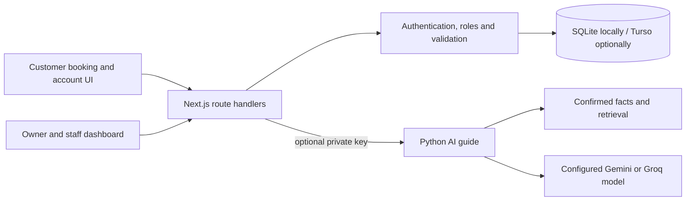

# Service Booking & Operations Demo

**Scheduling, customer accounts, staff permissions, payment records and an optional document-grounded AI guide.**

Built by **Bosko Tutnjilovic**, founder of [Synq Logic](https://synqlogic.com), as a business automation portfolio project. The original demonstration brand is **Studio Princess**; its interface is in Serbian / Bosnian. [Live demonstration](https://studio-princess-demo.vercel.app) · [English walkthrough](docs/walkthrough.md) · [Original Serbian documentation](docs/README.sr.md)

This project connects customer self-service to the operations behind it: availability, staff schedules, appointment conflicts, client records and daily reporting. It includes a separate Python AI backend grounded in a small set of confirmed facts. The AI guide is optional; booking and administration work without it.

## What employers can inspect

- **Scheduling logic:** working hours, staff skills, shift / time-off rules and conditional SQL writes to reject overlapping appointments.
- **Customer accounts:** expiring one-time-code challenges, attempt limits, hashed sessions, secure cookie settings, own-booking restrictions, and optional Google OAuth with state / PKCE.
- **Staff operations:** owner / staff roles, team and service management, client history and availability management.
- **Payment records:** validated amounts, idempotency handling and reversal records. This does **not** charge cards or capture money.
- **AI integration:** Next.js proxy to an authenticated Python / LangGraph service, retrieval of confirmed facts and evaluation cases.
- **Tests:** booking conflicts, authorization boundaries, client handling, payments and staff rules using isolated test databases.



## Run locally

Requires Node.js 24+ and npm. Python 3.12+ / uv are needed only for the optional AI backend.

```bash
git clone https://github.com/skabo42000/service-booking-operations-demo.git
cd service-booking-operations-demo
npm ci
# Copy .env.example to .env.local, then set a random DEMO_ADMIN_KEY.
npm run dev
```

Open `http://localhost:3000`; the staff interface is `/admin`. Generate a random `DEMO_ADMIN_KEY` of at least 20 characters. Do not publish or reuse it elsewhere. With Turso variables empty, the app creates a local demo database under ignored `data/`.

### Customer sign-in in the demo

There is **no email-delivery integration**. The public reference defaults `DEMO_SHOW_LOGIN_CODE=off`; email-code login returns an unavailable response until a delivery mechanism exists or you explicitly enable the demonstration.

For a synthetic local walkthrough only, set `DEMO_SHOW_LOGIN_CODE=on`. The code will then be displayed to the browser, so it proves no control of the email address. Use made-up accounts only. This must never protect real customer records. The shared staff key and selectable identities are also demo access, not individual production identity management.

## Checks

```bash
npm test
npm run typecheck
npm run lint
npm run build
```

Tests use temporary databases and do not send messages, charge money or create appointments with external businesses.

## Optional AI guide

Set the same random `ASSISTANT_API_KEY` in the Next.js and Python environments. Set `ASSISTANT_BACKEND_URL=http://127.0.0.1:8001` for local use, plus your own provider credentials. The backend loads the root `.env.local`; keep that file private.

```bash
cd ai_backend
uv sync --locked
uv run python -m princess_ai.rag
uv run uvicorn princess_ai.api:app --host 127.0.0.1 --port 8001
```

Building the retrieval index and using the guide may call external providers and incur costs. It cannot independently book, cancel or charge anything: booking remains in the validated application routes. Review `ai_backend/docs/confirmed.md` before changing the business configuration.

The AI backend and eight evaluation cases are present in source. This public release did not exercise live model calls or verify a deployed AI service. Reported historical results in the original documentation are development observations on a small fixed set, not a current production guarantee.

## Project map

| Path | Purpose |
|---|---|
| `app/zakazivanje/`, `app/moji-termini/` | Booking and customer account interface |
| `app/admin/` | Staff calendar, clients, reports, services and team |
| `app/api/` | Customer, staff and AI proxy endpoints |
| `lib/booking.ts`, `lib/db.ts` | Availability rules, conflict checks and database setup |
| `lib/auth.ts`, `lib/staff.ts`, `lib/protection.ts` | Sessions, authorization and request controls |
| `lib/payments.ts`, `lib/clients.ts` | Payment records and client operations |
| `ai_backend/` | Optional retrieval / LangGraph guide |
| `tests/` | Offline behavioral checks |

## Deployment limits

Use only synthetic records in this demo. The local database, reset behavior, exposed-code mode and shared staff key are unsuitable for real customer operations. A production adaptation needs verified identities / email delivery, confirmed services and schedules, durable backups, retention controls and notifications.

Turnstile is required in production unless the explicit demo `BOT_CHECK=off` bypass is set. Do not use that bypass for real bookings. Trusted-proxy configuration is necessary for IP-based rate controls. Payment records are bookkeeping demonstrations, not a payment processor. The UI's business content is demonstration content.

See [SECURITY.md](SECURITY.md). Existing font licenses are preserved in `assets/`.
